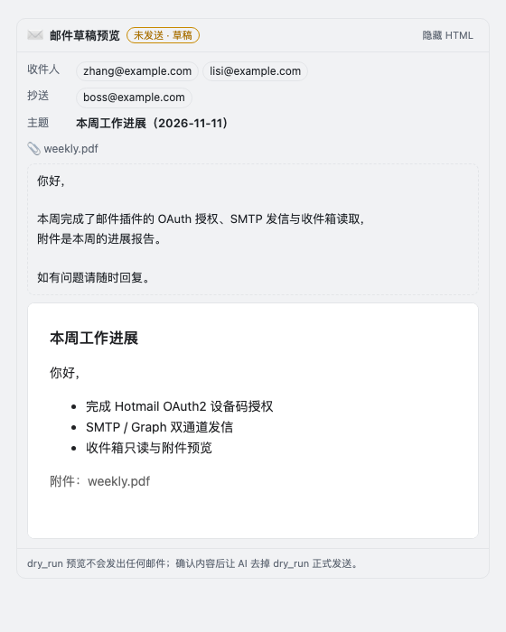

# dsh-email —— 让 AI 真正把邮件发出去

DeepSeek Harness（DSH）邮件插件。**Hotmail / Outlook 走微软设备码 OAuth2，其它邮箱走普通 SMTP**，附带只读收件箱，让 AI 能「看信 → 写 → 发」走完一条完整链路。

- 零运行时依赖：SMTP、MIME、OAuth2、Graph、IMAP 全部用 Node 标准库实现，不装 nodemailer/imapflow。
- 参考实现：`lite-work-plugins/plugins/email-plugin` 的 OAuth/收发思路 + `dsh-astock` 已在真实邮箱上跑过的 SMTP 状态机与设备码流程。补上了附件、Graph 大附件上传会话、纯文本兜底、发信审计、SMTP 自检与更明确的错误说明。
- 安全默认：发信前强制 `dry_run` 预览；附件默认只允许工作区；密码不回显；读信工具不会标记已读或删除邮件。

> 版本 0.1.0，未发布到 npm。当前是本地包，用 `link:` 安装最方便。

---

## 目录

- [能做什么](#features)
- [安装](#install)
- [配置](#config)
- [Hotmail / Outlook 授权](#oauth)
- [QQ / 163 / Gmail 等授权码邮箱](#basic)
- [工具与用法](#tools)
- [安全边界](#security)
- [故障排查](#troubleshoot)
- [开发与测试](#develop)
- [已知限制](#limits)

<a id="features"></a>
## 能做什么

| 能力 | 说明 |
|---|---|
| 发信 | SMTP（465 隐式 TLS / 587 STARTTLS）、Microsoft Graph（HTTPS 443） |
| 自动容错 | Graph 被网络拦（5xx/超时）→ 自动切 SMTP 并**熔断 10 分钟**（期间不再每封等超时）；SMTP 主入口握手失败 → 自动换备用入口；网络抖动自动重试（认证/地址类错误不重试） |
| OAuth2 | 微软设备码流程，一次授权长期有效；refresh_token 自动续期 |
| 普通密码 | QQ / 163 / 126 / 新浪 / 阿里云 / iCloud / Zoho / Fastmail / 自定义 SMTP，用授权码或应用专用密码 |
| 正文 | 纯文本 + HTML；只给 HTML 时自动生成纯文本兜底 |
| 附件 | 单封总大小默认 20MB；Graph 超过 3MB 自动走上传会话分片 |
| 收件（只读） | `email_mailbox`：列文件夹、列邮件、搜索、读单封 |
| 搜索 | `email_mailbox(action=search)`：关键词（中文走 UTF-8 literal 由服务端检索，失败自动本地兜底）+ 范围限定（主题/发件人/收件人/正文）+ 时间窗口（since/until/days，服务端筛完再本地复核）+ 跨文件夹 + 新旧排序，返回命中表格与**命中片段** |
| 审计 | `sends.jsonl` 记录发件时间/收件人/主题/通道/结果，不含正文 |
| 预览 | `dry_run=true` 不联网、不读令牌，只返回草稿 |
| 对话内预览卡 | 浏览器半侧把 `email_send` 调用渲染成邮件卡：收件人/抄送/密送、主题、正文、附件、HTML 预览（sandbox iframe），并区分草稿/发送中/已发送/失败 |
| 自检 | `email_account(action=status, probe=true)` 真实登录一次（不发信） |

**它不是**：群发工具、营销邮件系统、邮件客户端替代品；没有删除/移动/标记已读的能力，也不保存已发送副本到服务器（Graph 会保存到「已发送」，SMTP 不会）。

<a id="install"></a>
## 安装

DSH 桌面版用的是 `desktop` profile，命令行安装：

```sh
# 本地开发（软链，改源码后重启/重新启用插件即生效）
"/Applications/DeepSeek Harness.app/Contents/Resources/runtime/cli/bin/dsh" \
  plugin --profile desktop add link:/Users/layne/codes/dsh-email
```

如果你已经把 `dsh` 放进 PATH，直接：

```sh
dsh plugin --profile desktop add link:/Users/layne/codes/dsh-email
```

安装后重启 DSH（或到「设置 → 插件」里重新启用）。卸载：

```sh
dsh plugin --profile desktop remove @laynepeng/dsh-email
```

> 包名是 `@laynepeng/dsh-email`。不要直接手改 profile 的 `cordis.patch.yml`——本包自带的 bundle patch 会在安装时应用，手贴会重复插入。

### 三分钟跑通

1. 安装并重启 DSH（见上）。
2. **设置 → 插件 → 邮件助手**：选服务商、填邮箱账号；Hotmail/Outlook 选 `oauth2`，其它邮箱填授权码。
3. 对 AI 说「授权邮件」→ 按返回的网址和代码在浏览器完成授权（Hotmail/Outlook）。
4. 对 AI 说：「给 me@example.com 发一封测试邮件，主题『测试』，正文『你好』，先预览」。
5. 看到草稿没问题，再说「发送」。

<a id="config"></a>
## 配置

位置：**设置 → 插件 → 邮件助手**。字段都声明为 `volatile`，保存后立即生效，不用重启。

| 字段 | 说明 | 默认 |
|---|---|---|
| `provider` | 服务商：`outlook`（Hotmail/Outlook）/ `qq` / `163` / `126` / `gmail` / `sina` / `aliyun` / `icloud` / `zoho` / `fastmail` / `custom` | `outlook` |
| `auth` | `auto` / `oauth2`（微软设备码）/ `basic`（密码/授权码）；auto 按服务商选。选错会自动纠正 | `auto` |
| `username` | 完整邮箱地址 | — |
| `password` | basic 模式的密码/授权码（secret，不回显） | — |
| `fromName` | 发件人显示名 | 空 |
| `fromAddress` | 发件人地址，留空＝`username` | 空 |
| `transport` | `auto` / `graph` / `smtp`；auto＝Outlook 走 Graph、其它走 SMTP | `auto` |
| `smtpHost` / `smtpPort` / `smtpTls` | 全部留空＝用服务商预设；`ssl`=465，`starttls`=587。显式填了才覆盖预设 | 空 |
| `imapHost` / `imapPort` | 只影响收件；留空用服务商预设 | 按预设 |
| `oauthTenant` | 个人账号**留空**；组织账号填租户域名/ID；不能填邮箱 | 空 |
| `oauthClientId` | 留空＝内置公共客户端；用自己 Azure 应用时填（需允许公共客户端流） | 空 |
| `oauthScope` | 高级：覆盖默认 scope（必须同一资源） | 按通道 |
| `dataDir` | 令牌与审计目录 | `$DSH_HOME/email-data` |
| `maxAttachmentMb` | 单封附件总上限 | `20` |
| `allowAttachmentDirs` | 额外允许读附件的目录（分号分隔） | 空＝只允许工作区 |
| `signature` | 默认签名（纯文本） | 空 |
| `allowInsecure` | 允许明文 SMTP（仅本机中继/测试） | `false` |

也可以用环境变量兜底（显式配置优先）：`DSH_EMAIL_USERNAME`、`DSH_EMAIL_PASSWORD`、`DSH_EMAIL_OAUTH_TENANT`、`DSH_EMAIL_OAUTH_CLIENT_ID`。

<a id="oauth"></a>
## Hotmail / Outlook 授权（OAuth2）

Outlook 个人版已关闭 SMTP Basic Auth（`535 5.7.139`），必须用 OAuth2。本插件用**设备码流程**，不需要回调端口、不需要客户端密钥。

1. 设置里选 `provider=outlook`、`auth=oauth2`，填 `username`（如 `me@hotmail.com`），保存。
2. 对 AI 说「授权邮件」或直接让它调用 `email_account(action=authorize)`。
3. 它会返回一个网址（`https://microsoft.com/devicelogin`）和 8 位代码：
   - 打开网址 → 输入代码 → 用要发信的微软账号登录 → 同意「发送邮件 / 读取邮件」权限。
4. 完成浏览器操作后，让它调用 `email_account(action=poll)`（可带 `wait_seconds` 等待）。成功后 refresh_token 落到本机 `oauth.json`（0600），之后自动续期。

细节：

- **默认走 Graph（HTTPS 443）**，Graph 不可用时**自动回落 SMTP**（同一 refresh_token 换 `outlook.office.com/SMTP.Send` 的令牌，不需要重新授权）。想固定走 SMTP 就把 `transport` 改成 `smtp`。
- **Outlook 的 SMTP 主入口是 `smtp.office365.com:587`**，备用 `smtp-mail.outlook.com`。实测（2026-11）`smtp-mail.outlook.com` 在 STARTTLS 升级阶段会被部分网络重置（4/4 失败），而 `smtp.office365.com` 稳定成功；两者是同一套后端，只是入口不同。
- 内置公共客户端是 lite-work 在 Azure 注册的多租户公共客户端。如果它将来不可用，或你有自己的 Azure 应用：在 `oauthClientId` 填应用 ID，并在 Azure 里允许「公共客户端流」。
- 组织账号（M365）把 `oauthTenant` 填成租户域名或 GUID；个人账号留空（会按 `common` 处理）。填邮箱会报 `AADSTS900023`，插件会提前纠正并提示。
- 换账号、撤销授权、改密码后：先 `email_account(action=logout)`，再重新 `authorize`。

<a id="basic"></a>
## QQ / 163 / Gmail 等授权码邮箱

1. 到邮箱网页版设置里开启 **SMTP/IMAP 服务**，生成「授权码 / 应用专用密码」。
2. 设置里选对应 `provider`，填 `username` 与 `password`（填授权码，不是登录密码），保存。
3. 调用 `email_account(action=status, probe=true)`：它会真实连一次 SMTP 并登录，但**不发信**。

服务商预设（服务器/端口/TLS 自动带出）：

| 服务商 | SMTP | 方式 | IMAP |
|---|---|---|---|
| QQ | smtp.qq.com:465 | ssl | imap.qq.com:993 |
| 163 | smtp.163.com:465 | ssl | imap.163.com:993 |
| 126 | smtp.126.com:465 | ssl | imap.126.com:993 |
| Gmail | smtp.gmail.com:465 | ssl | imap.gmail.com:993 |
| 新浪 | smtp.sina.com:465 | ssl | imap.sina.com:993 |
| 阿里云 | smtp.aliyun.com:465 | ssl | imap.aliyun.com:993 |
| iCloud | smtp.mail.me.com:587 | starttls | imap.mail.me.com:993 |
| Zoho | smtp.zoho.com:465 | ssl | imap.zoho.com:993 |
| Fastmail | smtp.fastmail.com:465 | ssl | imap.fastmail.com:993 |

自建/企业邮箱选 `custom`，手填服务器、端口、加密方式（465=ssl，587=starttls）。IMAP 只支持 993 隐式 TLS；143+STARTTLS 暂不支持。

<a id="tools"></a>
## 工具与用法

插件注册 6 个工具：

### `email_send`

发送一封邮件。参数：`to`、`cc`、`bcc`（逗号分隔）、`subject`、`body`、`html`、`attachments`（工作区内路径数组）、`reply_to`、`in_reply_to`、`references`、`dry_run`。

推荐流程（插件会在系统提示里要求模型遵守）：

```text
1. email_send(dry_run=true)          ← 只预览，不联网
2. 把收件人/主题/正文给用户确认
3. email_send(dry_run 不传)          ← 正式发送
```

写邮件示例：

> 用邮件助手给 zhang@example.com 发一封周报，主题「本周进展」，正文列出三点，附件用 workspace 里的 weekly.pdf。先预览给我看。

**对话里的邮件卡**：`email_send` 调用会显示一张预览卡（浏览器半侧 `lib/client.js`），从调用参数渲染，不额外请求宿主：



- 浅色 / 深色主题自动跟随，窄侧栏下收件人标签自动折行；
- 徽标明确区分 **未发送 · 草稿**（`dry_run`）、**发送中…**、**已发送 · 服务器已接收**、**发送失败**；
- 正文默认展示前约 11 行，长正文可「展开全文」；
- 有 `html` 时出现「查看 HTML」，在 **sandbox iframe** 里渲染（禁脚本、禁表单、禁嵌套框架），不会把邮件 HTML 注入 DSH 页面；
- 失败时即使工具按约定返回 `[Error]` 文本而不是抛异常，卡片也会识别为失败，不会误报「已发送」；
- 卡片只做展示，**发送动作仍要用户对 AI 说「发送」**，避免在 UI 里绕过对话确认。

### `email_account`

`action=status` 看配置/授权/通道/还缺什么/最近发信；`probe=true` 会真实登录一次（Graph 只读探针或 SMTP 登录），不发信。

`action=authorize | poll | cancel | logout` 处理设备码授权，`wait_seconds` 用于 poll 等待（上限 120 秒）。适合「授权邮件」「重新授权」「退出登录」这类对话。

### `email_mailbox`

`action` 决定做什么（默认 `list`）：

- **`search`：找邮件用这个**。
  - `query` 关键词；`in` 限定范围（`auto`/`subject`/`from`/`to`/`body`）
  - 时间：`since` / `until`（`YYYY-MM-DD`，含当天）、`days=N`（最近 N 天）、`after`/`before` 别名
  - `from`/`to` 结构化过滤、`unread`、`all_folders=true` 跨文件夹（≤25 个）、`scan` 本地兜底回溯量（默认 200，≤500）、`sort`（`newest`/`oldest`）、`max`（≤50）
  - 返回命中表格（时间/发件人/主题/**命中字段**/UID）+ **命中片段**（优先展示正文上下文）
  - 中文关键词：先按 UTF-8 literal 交给服务端 `SEARCH`；服务器不支持（BAD/NO）时自动退回本地扫描，结果里会写明范围
- **`list`**：`folder`、`from`、`subject`、`keyword`、`unread`、`since`/`until`/`days`、`sort`、`max`（≤50）。返回 UID/时间/发件人/主题，🔵 未读、📎 有附件。
- **`read`**：`uid`（+ `folder`），返回头部、正文（HTML 自动转纯文本）、附件清单；不下载附件内容。大于 2MB 只读头和部分正文并标注。
- **`folders`**：列文件夹与未读数（中文文件夹名自动 UTF-7 编解码）。

`keyword` 含中文时，服务器 SEARCH 只支持 ASCII，所以插件会取最近 40 封的正文前 16KB 在本地匹配——这是**有意的取舍**，结果里会写明。

> 发信不依赖 IMAP。`imapHost` 没填时，收件工具会明确提示，不影响发信。

<a id="security"></a>
## 安全边界

- **附件只允许工作区**：模型不能把 `~/.ssh/id_rsa` 当附件发出去。需要额外目录时由用户显式配置 `allowAttachmentDirs`。
- **密码是 secret 字段**：设置页不回显；`email_account(action=status)` 只说明「填了没」；发信审计不含密码和令牌。
- **令牌文件 0600、目录 0700**；不存在配置里，不会被顺手提交到 git。
- **发信前预览**：工具描述与系统提示都要求先 `dry_run`、等用户确认。这不是「审批弹窗」，而是对话里的确认——DSH 的工具权限门禁属于宿主策略，本插件没有内建弹窗。
- **只读收件**：没有删除/移动/标记已读工具。`BODY.PEEK` 不会把邮件标成已读。
- **不虚报结果**：成功只说「服务器已接收」，不说「已送达」；`email_account(action=status)` 不写「已验证」。
- **拒绝明文**：`smtpTls=none` 默认被拒绝，除非显式 `allowInsecure`（给本机中继/测试）。

<a id="troubleshoot"></a>
## 故障排查

| 现象 | 原因 / 处理 |
|---|---|
| `SMTP 认证失败（535）` | QQ/163/Gmail 要用**授权码**；Outlook 个人版必须 OAuth2。 |
| `535 5.7.139` | 微软关闭了 Basic Auth：把 `auth` 改成 `oauth2` 并完成设备码授权。 |
| `501 5.1.7 Invalid address` | 地址里混了中文/全角字符。插件会清洗，但仍请检查 `fromAddress` 与收件人。 |
| `550/553` | 收件人不存在，或发件人不属于登录账号（多数服务商要求 `fromAddress` = `username`）。 |
| `554` / 被判垃圾邮件 | 降低链接密度、换主题；让收件人先把发件人加白名单。 |
| 连接超时 / 被拒绝 | 网络或防火墙封了 465/587。Outlook 把 `transport` 改成 `graph`；其它邮箱换 465/587 试试。 |
| `STARTTLS` 未声明 | 端口与加密方式不匹配：465 用 `ssl`，587 用 `starttls`。插件会按端口自动纠正。 |
| 令牌权限与通道不一致 | 只有**缺少**必需权限才要求重新授权；多授权其它权限不会被拦（`offline_access` 不算必需项）。 |
| `Graph 与 SMTP 两条通道都失败` | 报错会同时给两条原因。常见是网络同时拦了 graph 与 smtp-mail 入口；插件已默认用 `smtp.office365.com` 并自动换入口，仍失败再换网络。 |
| 授权页报 `AADSTS900023` | 租户里填了邮箱：清空 `oauthTenant`（个人账号）或填租户域名/ID。 |
| `AADSTS65001` | 用户/管理员未同意：重新授权并在浏览器点同意；组织账号可能需要管理员批准。 |
| 收件提示 IMAP 登录失败 | 服务商要求授权码；Outlook 需要 OAuth2。先确认网页版已开启 IMAP。 |
| 收件提示「Graph 通道不含 IMAP 权限」 | 默认 Graph 只用于发信：把 `transport` 改 `smtp` 并重新授权；不改也能正常发信。 |
| 设置页没有表单 | 确认安装的是 bundle（`dsh.bundle.patch`），并在「设置 → 插件」里找到「邮件助手」；`Config` 依赖宿主提供的 `@deepseek-ai/schemastery`。 |
| 沙箱里 selftest 报目录不可写 | DSH 文件沙箱只允许工作区；真实应用里 `$DSH_HOME` 可写。 |

**额外诊断**：插件在宿主 Web 服务上挂了一个只读端点 `GET /api/dsh-email/status`（不含密码/令牌），浏览器打开当前 DSH 地址 + 该路径即可看到与 `email_account(action=status)` 同源的状态。

<a id="develop"></a>
## 开发与测试

```sh
cd /Users/layne/codes/dsh-email

node --test test/*.test.mjs     # 89 个测试（假 SMTP/OAuth/Graph/IMAP + MIME + 客户端预览卡）
node scripts/check-tools.mjs    # 工具契约校验
node scripts/selftest.mjs       # 无需 DSH 宿主的环境自检
```

测试不是 mock 到「函数被调用」为止：

- `test/helpers/fake-smtp.mjs`：真实 SMTP 状态机，含 EHLO、AUTH LOGIN/PLAIN/XOAUTH2、DATA 点转义、STARTTLS 升级（openssl 自签证书）。
- `test/helpers/fake-oauth.mjs`：设备码 + 轮询 + refresh_token 端点。
- `test/helpers/fake-imap.mjs`：LOGIN/XOAUTH2、SELECT、UID SEARCH/FETCH（支持 literal）、LIST/STATUS。
- `test/graph.test.mjs`：小附件一次 sendMail；大附件草稿→上传会话分片→发送；失败清理草稿。

代码结构：

```text
lib/
  entry.js / boot.js        稳定入口 + 缓存键热重载（改子模块后启停即可）
  plugin.js                 注册工具、系统提示、只读状态端点
  client.js                 浏览器半侧：email_send 的邮件预览卡（tool.call.toolview）
  config-schema.js          设置页 schema（volatile 字段 + secret）
  tools.json                工具契约（唯一事实源）
  js/
    config.js               配置归一化、预设推导、地址清洗、就绪检查
    providers.js            服务商预设、scope、租户规范化
    message.js              MIME 组装、RFC 2047/2231、附件路径守卫
    smtp.js                 SMTP 状态机（TLS/STARTTLS/XOAUTH2）、自检
    oauth.js                设备码、令牌续期、错误翻译
    graph.js                Graph 发信（大附件上传会话）
    mime.js                 收件解析（multipart/字符集/RFC2047）
    imap.js                 IMAP 只读（UTF-7、literal、SEARCH/FETCH）
    store.js                oauth.json / sends.jsonl（0600）
    send.js                 发信编排 + dry_run 预览 + 审计
    status.js               状态与联网自检
```

修完子模块后，在「设置 → 插件」里把邮件助手关掉再打开即可重新加载；`boot.js` 用版本号+时间戳做缓存键，Node 不会继续跑旧模块。

<a id="limits"></a>
## 已知限制

- **单账号**：一次只配置一个邮箱。多账号需要多套配置（可后续加 accounts 数组）。
- **没有回复/转发专用工具**：可以 `email_mailbox(action=read)` 拿到原文后用 `email_send` 手工带 `in_reply_to` / `references` 回复（不会自动引用原文、不会自动抄送）。Graph 通道会忽略这两个头（Graph 用自己的会话机制），SMTP 通道会正常带上。
- **不下载附件**：只列附件名/类型/大小。需要附件内容时请用户自己从客户端取。
- **SMTP 发信不自动存「已发送」**：Graph 会存；SMTP 需要 IMAP APPEND，暂未实现。
- **IMAP 只支持 993 隐式 TLS**，不支持 143 + STARTTLS。
- **Graph 通道只解决发信**：Graph 令牌不含 IMAP 权限，所以默认 `transport=graph` 时收件工具会明确提示；要读收件箱需切到 `smtp` 并重新授权（如果网络允许 SMTP）。
- **内置 OAuth 客户端**依赖第三方 Azure 公共客户端；组织策略可能要求管理员同意，或需要你填自己的 `oauthClientId`。
- **没有 DKIM 签名**；大附件走服务器限制（Graph 150MB，普通 SMTP 通常 25MB）。
- **平面文本里的中文关键词搜索在本地区域完成**，只扫最近 40 封；要全量搜索需要服务器支持 UTF-8 SEARCH（未实现）。
- 未做「发信审批弹窗」：确认发生在对话里（`dry_run` → 用户点头 → 正式发）。如果你需要强制门禁，用 DSH 的 `tools/pre-execute` 策略挂在本插件上。

## 致谢

SMTP 状态机、微软设备码 OAuth2 与 Graph 发信思路参考/改编自：

- [dsh-astock](https://github.com/LaynePeng/dsh-astock)（Apache-2.0）
- [lite-work-plugins / email-plugin](https://github.com/LaynePeng/lite-work-plugins)（Apache-2.0）

MIME 组装/解析、IMAP 只读、附件路径守卫、发信审计与测试假服务器为本项目实现。详见 [NOTICE](NOTICE) 与 [LICENSES/Apache-2.0.txt](LICENSES/Apache-2.0.txt)。

## License

MIT
